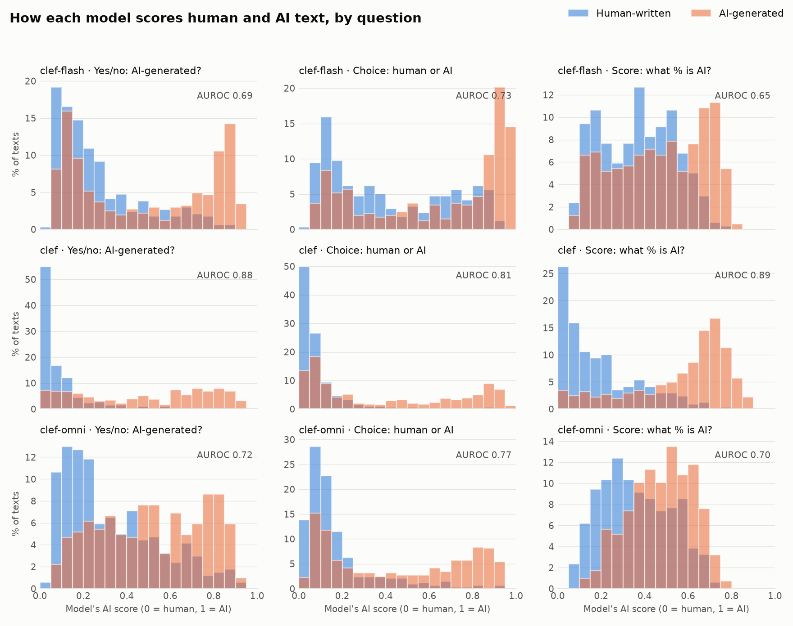
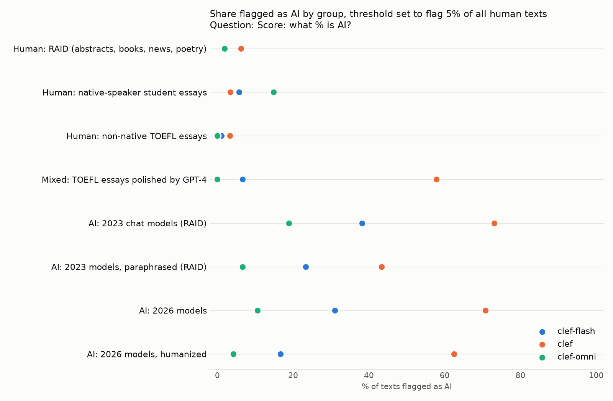

# ai-text-detection-eval

Can a general-purpose *decision model* tell human writing from AI writing with no training at all?

This repository is a small, reproducible experiment that answers that for Cloudflare's Clef decision
models on Workers AI. It compiles 836 labelled texts, asks each model three typed questions about every
text, and reports how well the answers separate human from AI writing.

It is an evaluation harness, not a detector. Nothing here should be used to accuse anyone of using AI.

## Result in brief (13 November 2026)

| Model | Best question | AUROC | AI caught when 5% of humans are flagged | ...when 1% are flagged |
|---|---|---|---|---|
| `clef` (27B) | "What percentage of this text is AI-generated?" | 0.89 | 67% | 46% |
| `clef-omni` (30B MoE, 3B active) | "Who wrote this text?" (human / AI) | 0.77 | 43% | 21% |
| `clef-flash` (9B) | "Who wrote this text?" (human / AI) | 0.73 | 41% | 35% |

- **The largest model has real signal; the two smaller ones are weak.** `clef` separates the groups far
  better than chance, including on text from 2026 models it cannot have seen (71% caught at 5% FPR) and
  on humanized rewrites (62%). Paraphrased 2023 text is harder (43%).
- **It is still not accusation-grade.** At a 1% false-positive rate it misses more than half of AI text.
- **Question wording matters as much as model choice.** For `clef`, the yes/no and percentage questions
  score 0.88-0.89 AUROC while the human/AI choice scores 0.81 on the same texts.
- **Edited text has no clean answer.** `clef` flags 58% of TOEFL essays that a human wrote and GPT-4 then
  polished, against 3% of the unpolished originals.
- **No sign of bias against non-native writers here,** unlike the 2023 detectors studied by Liang et al.:
  `clef` flags 3% of non-native TOEFL essays and 3% of native student essays at the same threshold. The
  sample is small (91 and 88 essays) and the essays are short.
- **Ask one question per request.** Scores shift by 0.05-0.28 on average when the three questions share a
  request, and `clef-flash` is not fully repeatable run to run.

Full tables: [results/report.md](results/report.md). Machine-readable: [results/summary.json](results/summary.json).





## Read this before trusting the numbers

- **Every human text is old and public.** RAID's human documents and the essay sets predate these models
  and may be in their training data. A model that recognises a text has an unfair route to "human", so the
  false-positive rates here are probably optimistic. Unpublished human writing is the missing test.
- **Short excerpts.** Texts are trimmed to at most 150 words (TOEFL essays are about 100). Detectors
  generally improve with length, so longer documents may score better.
- **Four RAID domains only** (abstracts, books, news, poetry), because the hosted parquet conversion of
  RAID is partial. No reviews, recipes, Reddit posts or code.
- **The humanizer is one prompt**, not a commercial humanizer tool. Real tools may evade detection more.
- **Small groups.** Per-writer counts are 6-36 texts; intervals in the report are bootstrap 95% CIs.
- **Thresholds were chosen on the same data they are evaluated on.** A held-out threshold would do a
  little worse.
- **Calibration depends on the mix.** The set is 55% AI. The percentage score tracks the true share
  reasonably here, and would not in a population that is mostly human.
- **Native essays were edited.** Their anonymisation tokens (`@CAPS1`, `@LOCATION2`) were replaced with
  plain fillers so the tokens could not mark them as corpus text.
- **OpenAI's Decisions endpoint and TypeSafe AI's Jev were not tested.** The first returned HTTP 429 on
  every inference call from the account used; the second is not on Workers AI.

## The evaluation set

| Label | Group | Texts | Source |
|---|---|---|---|
| human | `raid_human` | 160 | RAID human documents, 40 per domain |
| human | `essay_native` | 88 | US student essays (Liang et al. 2023, from Hewlett ASAP) |
| human | `essay_nonnative` | 91 | TOEFL essays by non-native writers (Liang et al. 2023) |
| ai | `raid_2023` | 186 | RAID generations from ChatGPT, GPT-4, Llama 2, Mistral, Cohere, MPT |
| ai | `raid_paraphrased` | 60 | RAID generations after its paraphrase attack |
| ai | `fresh_2026` | 113 | Generated for this study by eight current Workers AI models |
| ai | `humanized_2026` | 48 | Some of those, rewritten by a second model to "sound like a person" |
| mixed | `toefl_gpt4_polished` | 90 | The TOEFL essays after GPT-4 polishing (Liang et al. 2023) |

Human and AI texts from RAID and the fresh generations share source titles, so topics match. Every text is
stripped of chat markdown, collapsed to single spaces and trimmed to 60-150 words at a sentence end.
Details and field descriptions are in [data/README.md](data/README.md).

## The questions

Each text is sent as the model's `state` with one typed question per request
([src/detecteval/questions.py](src/detecteval/questions.py)):

1. **Yes/no** — "Was this text generated by an AI language model rather than written by a human?"
2. **Choice** — "Who wrote this text?" with options `human` and `ai`.
3. **Score** — "What percentage of this text is AI-generated?" on five levels from 0% to 100%.

Each answer becomes a 0-1 score where higher means more likely AI.

## Reproduce

Prerequisites: Python 3.11+, [uv](https://docs.astral.sh/uv/), and a Cloudflare account with Workers AI.

```sh
git clone https://github.com/ichen27/ai-text-detection-eval.git
cd ai-text-detection-eval
uv sync
bash ci/run.sh                       # lint and unit tests; needs no credentials
uv run python -m detecteval.report   # rebuild the report and figures from the committed scores
```

To call the models yourself, create `.env` in the repository root (it is ignored by Git):

```sh
MCP_URL=https://mcp.cloudflare.com/mcp     # or a gateway that fronts it
MCP_TOKEN_FILE=/path/to/cloudflare-api-token.txt
MCP_TOOL_PREFIX=                           # set if your gateway prefixes tool names
RAW_DATA_DIR=raw                           # where raw downloads go
```

The token needs Workers AI read and run permission. Then:

```sh
uv run python -m detecteval.fetch_raid       # about 2.4 GB download, then a seeded sample
uv run python -m detecteval.fetch_essays
uv run python -m detecteval.generate         # paid: fresh and humanized texts; outputs differ each run
uv run python -m detecteval.build_dataset
uv run python -m detecteval.score clef-flash clef clef-omni
uv run python -m detecteval.score clef-flash clef clef-omni --variant joint
uv run python -m detecteval.score clef-flash clef clef-omni --variant repeat --limit 100
uv run python -m detecteval.report
```

Scoring and generation are resumable. To rescore the committed set without regenerating anything, skip
straight to the `score` commands after deleting `results/scores/`.

Verified here: the pipeline ran through a private MCP gateway in front of Cloudflare's API MCP server.
Pointing `MCP_URL` directly at `https://mcp.cloudflare.com/mcp` uses the same tool and should behave the
same, but that path was not run.

### Cost

The committed score files account for about 4 million input tokens across the three models (roughly
0.60 US dollars at Workers AI list prices). With discarded trial runs and 161 short generations from
reasoning models, the whole study is estimated at 1 to 3 dollars. This is an estimate, not a bill.

## Layout

```
src/detecteval/   pipeline: fetch_raid, fetch_essays, generate, build_dataset, score, report
data/             eval_set.jsonl (scored texts), generated.jsonl (raw generations)
results/          scores per model, summary.json, report.md, figures/
tests/            unit tests for metrics and text preparation
ci/run.sh         single lint-and-test entry point used locally and in CI
```

## Contributing and issues

Open an issue for a wrong number, a broken command or a dataset concern. For changes, branch from `main`,
run `bash ci/run.sh`, and open a pull request; the `test` check must pass before merging. If you change
the dataset, prompts or seed, regenerate scores and the report in the same pull request.

## Licence and attribution

No licence has been chosen for the code yet, so default copyright applies. The evaluation set includes
short excerpts from RAID and from Liang et al. (2023), both MIT-licensed; see
[THIRD_PARTY_NOTICES.md](THIRD_PARTY_NOTICES.md).
