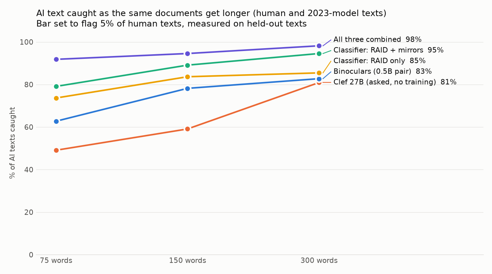
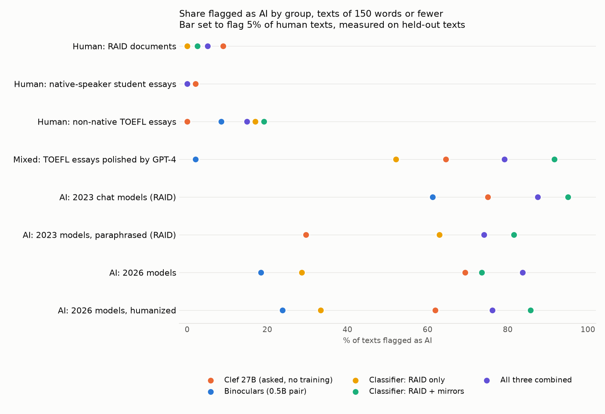

# ai-text-detection-eval

How well can AI-written text be told from human writing, and what improves it?

This repository is a small, reproducible experiment. It compiles labelled texts and compares three kinds
of detector on them:

1. asking a general-purpose *decision model* (Cloudflare's Clef, on Workers AI) with no training;
2. statistical detectors that need no training (Binoculars, Fast-DetectGPT);
3. a classifier trained on examples, with and without examples from current models.

It is an evaluation harness, not a detector. Nothing here should be used to accuse anyone of using AI.

## Results in brief (13 November 2026)

All numbers below are measured on texts that were not used to set the flagging bar. "AI caught" is the
share of AI texts flagged when the bar is set so that 5% of human texts would be flagged.

**Short texts (150 words or fewer), including text from 2026 models**

| Detector | AUROC | AI caught | Humans actually flagged | AI caught, bar set for 1% |
|---|---|---|---|---|
| Clef 27B, asked "what percentage is AI-generated?" | 0.89 | 65% | 5% | 40% |
| Binoculars (0.5B model pair) | 0.81 | 45% | 2% | 35% |
| Classifier trained on RAID (2023 models) | 0.88 | 61% | 5% | 33% |
| Classifier, RAID then updated with 264 current-model "mirrors" | 0.97 | 86% | 6% | 72% |
| Clef + Binoculars + classifier, combined | 0.97 | 83% | 6% | 63% |

**The same documents at three lengths (human text and 2023-era AI text)**

| Detector | 75 words | 150 words | 300 words |
|---|---|---|---|
| Clef 27B, asked | 49% | 59% | 81% |
| Binoculars | 63% | 78% | 83% |
| Classifier, RAID only | 74% | 84% | 85% |
| Classifier, RAID + mirrors | 79% | 89% | 95% |
| All three combined | 92% | 95% | 98% |



What the comparison shows:

- **Length helps every detector, the asked model most.** Clef goes from 49% caught at 75 words to 81% at
  300 on the same documents. Going from 300 to 500 words did not help the local detectors further.
- **Training on examples beats asking, but only with examples from current models.** A classifier trained
  on 2023-era text catches 29% of 2026-model text in the short set. After a nine-minute update on 264
  texts from four current models it catches 73%, and 60% of text from four current models it never saw.
- **Different kinds of detector make different mistakes, so they combine well.** At 300 words on 2023-era
  text, Clef and Binoculars each catch about 82%; a logistic regression over the two catches 96%. The
  three questions put to Clef in the first study did not combine this way, because they are one opinion.
- **Binoculars with a small model pair misses current models.** It catches 18% of 2026-model text in the
  short set. The published method uses 7B models; this 0.5B pair is a floor, not a fair ceiling.
- **The trained classifier is biased against non-native writers; Clef is not, in this sample.** With the bar
  set for 5% of all humans, the classifier flags 9 of 47 non-native TOEFL essays (19%) and 0 of 48 native
  student essays. Clef flags 0 of 47 and 1 of 48. This is the bias Liang et al. reported for 2023 detectors.
- **Edited text still has no clean answer.** The mirror-trained classifier flags 92% of TOEFL essays that a
  person wrote and GPT-4 polished; Clef flags 65%.
- **Recent human posts look more AI-like to Clef than 2019 posts do** (12% flagged against 3%; AUROC 0.71
  between the two groups). On reading, several of the highest-scoring recent posts appear to be written
  with AI help, so this does not show that Clef has memorised old text. It does mean "human writing
  published in 2026" is not a clean human sample.

Full tables: [results/comparison.md](results/comparison.md) (all detectors) and
[results/report.md](results/report.md) (first study: three Clef models, three questions).
Machine-readable: [results/comparison.json](results/comparison.json), [results/summary.json](results/summary.json).



## What is not finished

The MCP gateway used to reach Workers AI went down partway through the second study, so everything that
needs a paid Cloudflare call stopped where it was. The local detectors finished.

| Step | State |
|---|---|
| Long 2026-model texts (`generate_long`) | 79 of 160 generated; no humanized or polished texts yet |
| Clef on the long set | done for all human and 2023-era AI documents at 75, 150 and 300 words; not run on the 2026-model documents, so Clef has no 300-word result on current models and no 500-word result |
| Clef-flash and Clef-omni on the long set | Clef-flash partly scored and left out of the comparison; Clef-omni not started |
| Training mirrors (`generate_mirrors`) | 264 of 1,000 generated; the classifier update used those 264 |

Every one of those steps resumes where it stopped: rerun the commands in "Reproduce" and finished items
are skipped. Then rerun `train_classifier mirrors`, `classify`, `binoculars` and `compare`.

## Read this before trusting the numbers

- **Small test halves.** Each number rests on roughly 170 to 260 human and 110 to 180 AI texts. Group
  rows rest on 20 to 110 texts, and the seen/unseen generator comparison on about 25 each. Intervals are
  in the full tables.
- **A 1% bar is set by two or three texts.** The "bar set for 1%" columns are indicative only.
- **Human writing the models cannot have seen is still missing.** Recent forum posts were meant to fill
  that gap and turned out to include AI-assisted writing. Private writing that has never been online
  remains the clean test, and none was used.
- **The classifier's test is easier than real use.** Its human training text comes from the same seven
  RAID domains as much of the test set (different documents), and its mirrors use the same prompt style as
  the 2026 test texts. Student essays and the evaluation forum sites were kept out of training.
- **The classifier reads at most 512 tokens**, about 380 words, so it cannot gain from longer texts.
- **Binoculars runs on a 0.5B model pair** to fit in memory, far smaller than the published 7B pair.
- **The humanizer is one prompt**, not a commercial humanizer tool. Real tools may evade detection more.
- **Combination weights were fitted on a few hundred texts** and would need refitting for other text.
- **Calibration depends on the mix.** The sets are roughly half AI; scores read as probabilities would be
  wrong for a population that is mostly human.
- **Native essays were edited.** Their anonymisation tokens (`@CAPS1`, `@LOCATION2`) were replaced with
  plain fillers so the tokens could not mark them as corpus text.
- **Hidden reasoning was switched off for four generators** when writing the long texts, to stay inside
  the gateway's 60-second request limit. Their short-set texts were written with it on.
- **OpenAI's Decisions endpoint and TypeSafe AI's Jev were not tested.** The first returned HTTP 429 on
  every inference call from the account used; the second is not on Workers AI.

## The two evaluation sets

### Short set (`data/eval_set.jsonl`, 836 texts of 150 words or fewer)

| Label | Group | Texts | Source |
|---|---|---|---|
| human | `raid_human` | 160 | RAID human documents, 40 per domain (abstracts, books, news, poetry) |
| human | `essay_native` | 88 | US student essays (Liang et al. 2023, from Hewlett ASAP) |
| human | `essay_nonnative` | 91 | TOEFL essays by non-native writers (Liang et al. 2023) |
| ai | `raid_2023` | 186 | RAID generations from ChatGPT, GPT-4, Llama 2, Mistral, Cohere, MPT |
| ai | `raid_paraphrased` | 60 | RAID generations after its paraphrase attack |
| ai | `fresh_2026` | 113 | Generated for this study by eight current Workers AI models |
| ai | `humanized_2026` | 48 | Some of those, rewritten by a second model to "sound like a person" |
| mixed | `toefl_gpt4_polished` | 90 | The TOEFL essays after GPT-4 polishing (Liang et al. 2023) |

### Long set (`data/long_set.jsonl`, documents of 300 to 500 words)

Each document is scored cut to 75, 150, 300 and, where it is long enough, 500 words, so the effect of
length is measured on the same documents rather than on different ones.

| Label | Group | Documents | Source |
|---|---|---|---|
| human | `raid_human` | 210 | RAID human documents from seven domains (books, news, poetry, recipes, reviews, Reddit, Wikipedia) |
| human | `essay_native` | 76 | US student essays (Liang et al. 2023), those of 255 words or more |
| human | `forum_recent` | 116 | Stack Exchange questions posted from 10 October 2026, after the Clef models were released |
| human | `forum_2019` | 120 | Questions from the same sites and weeks of 2019 |
| ai | `raid_2023` | 166 | RAID generations from six 2023-era chat models |
| ai | `raid_paraphrased` | 64 | RAID generations after its paraphrase attack (books and news) |
| ai | `fresh_2026` | 78 | Generated for this study by eight current Workers AI models; about half of the 160 planned |

Planned and not yet in the set: humanized rewrites of the 2026 texts, human texts polished by a model, and
machine-written forum posts and student essays. See "What is not finished" above.

Human and AI texts share source titles where a title exists, so topics match. Every text is stripped of
chat markdown and collapsed to single spaces. Field descriptions are in [data/README.md](data/README.md).

## The detectors

1. **Asking a decision model** (no training). Each text is sent to a Clef model as its `state` with one
   typed question per request ([src/detecteval/questions.py](src/detecteval/questions.py)). The first
   study compared three questions; the percentage question ("What percentage of this text is
   AI-generated?", five levels) did best on `clef` and is the one used in the comparison.
2. **Binoculars and Fast-DetectGPT** (no training). Both measure how predictable a text is to a pair of
   small language models ([src/detecteval/binoculars.py](src/detecteval/binoculars.py)). The published
   versions use 7B-parameter models; this one uses a 0.5B pair so it fits in about 3 GB of memory.
3. **A trained classifier.** A DistilRoBERTa encoder (82M parameters) fine-tuned on RAID, in two
   versions: RAID only (2023-era machine text), and RAID plus "mirrors", texts written by four current
   models on the titles of human training documents
   ([src/detecteval/train_data.py](src/detecteval/train_data.py)).
4. **Combinations.** A logistic regression over the detectors' scores, fitted on the calibration half.

Every score is oriented so that higher means more likely AI.

## Reproduce

Prerequisites: Python 3.11+, [uv](https://docs.astral.sh/uv/). Calling the Clef models and generating
text also needs a Cloudflare account with Workers AI.

```sh
git clone https://github.com/ichen27/ai-text-detection-eval.git
cd ai-text-detection-eval
uv sync
bash ci/run.sh                        # lint and unit tests; needs no credentials
uv run python -m detecteval.report    # first study: rebuild report and figures from committed scores
uv run python -m detecteval.compare   # comparison of all detectors from committed scores
```

Those commands use only what is committed. To rerun the pipeline, create `.env` in the repository root
(it is ignored by Git):

```sh
MCP_URL=https://mcp.cloudflare.com/mcp     # or a gateway that fronts it
MCP_TOKEN_FILE=/path/to/cloudflare-api-token.txt
MCP_TOOL_PREFIX=                           # set if your gateway prefixes tool names
RAW_DATA_DIR=raw                           # where raw downloads and trained models go
```

The token needs Workers AI read and run permission.

First study (short set):

```sh
uv run python -m detecteval.fetch_raid       # about 2.4 GB download, then a seeded sample
uv run python -m detecteval.fetch_essays
uv run python -m detecteval.generate         # paid: fresh and humanized texts; outputs differ each run
uv run python -m detecteval.build_dataset
uv run python -m detecteval.score clef-flash clef clef-omni
uv run python -m detecteval.score clef-flash clef clef-omni --variant joint
uv run python -m detecteval.score clef-flash clef clef-omni --variant repeat --limit 100
uv run python -m detecteval.report
```

Second study (long set, local detectors, classifier):

```sh
uv run python -m detecteval.fetch_raid_full        # 0.8 GB
uv run python -m detecteval.fetch_stackexchange    # about 200 unauthenticated API requests
uv run python -m detecteval.build_long_set         # human and RAID texts
uv run python -m detecteval.generate_long          # paid: long AI, humanized and polished texts
uv run python -m detecteval.build_long_set         # again, to merge the generated texts in
uv run python -m detecteval.score_long clef --question pct_ai
uv run python -m detecteval.score_long clef-flash clef-omni --question author --rungs 150 300

uv sync --group ml                                 # PyTorch and Transformers for the local detectors
uv run python -m detecteval.binoculars
uv run python -m detecteval.generate_mirrors --shard 0 --of 1     # paid: 1,000 training texts
uv run python -m detecteval.generate_mirrors --merge
uv run python -m detecteval.train_classifier raid
uv run python -m detecteval.train_classifier mirrors
uv run python -m detecteval.classify raid mirrors
uv run python -m detecteval.compare
```

Scoring, generation and Binoculars are resumable: finished items are skipped on a rerun. The local
detectors need a few gigabytes of free memory each; run them one at a time. A request through an MCP
gateway may be cut off after 60 seconds, so `generate_long` turns off hidden reasoning for four models
and asks the slowest one for fewer words.

Verified here: the pipeline ran through a private MCP gateway in front of Cloudflare's API MCP server.
Pointing `MCP_URL` directly at `https://mcp.cloudflare.com/mcp` uses the same tool and should behave the
same, but that path was not run.

### Cost

Paid calls go to Workers AI. The first study's committed scores account for about 4 million input tokens
(roughly 0.60 US dollars at list prices). The second study so far adds about 1.6 million input tokens of
Clef scoring (about 0.30 dollars) and 343 generated texts. With discarded trial runs the whole project is
estimated at 2 to 5 dollars. This is an estimate, not a bill. Binoculars and the classifier run locally:
about 20 minutes and 55 minutes on an Apple M4, using 3 to 5 GB of memory.

## Artifacts

| Artifact | Where | Format | How to use or reproduce |
|---|---|---|---|
| Both evaluation sets | [data/eval_set.jsonl](data/eval_set.jsonl), [data/long_set.jsonl](data/long_set.jsonl) | JSON Lines | Fields in [data/README.md](data/README.md) |
| Generated texts and training mirrors | [data/](data/) | JSON Lines | `generate`, `generate_long`, `generate_mirrors` |
| Scores per detector | [results/scores/](results/scores/), [results/scores_long/](results/scores_long/), [results/detectors/](results/detectors/) | JSON Lines | `score`, `score_long`, `binoculars`, `classify` |
| Reports | [results/report.md](results/report.md), [results/comparison.md](results/comparison.md), with `.json` twins | Markdown, JSON | `report`, `compare` |
| Figures | [results/figures/](results/figures/) | PNG | `report`, `compare` |
| Trained classifiers (2 × 306 MB) | [release v0.2.0](https://github.com/ichen27/ai-text-detection-eval/releases/tag/v0.2.0) | Hugging Face model folders, gzipped tar | Extract into `RAW_DATA_DIR/models/`, then `python -m detecteval.classify raid mirrors`; or retrain with `train_classifier` |

SHA-256 of the release files: `classifier-raid.tar.gz` `81ae99d8aa214fe596a5799cac1b5a19c8f67da5989284e9639a3431d535a9f5`,
`classifier-mirrors.tar.gz` `796710924d893414557d895c9cb5b0a2b225d7cacc12686413625885ac621262`.

Raw third-party downloads are not redistributed; [data/README.md](data/README.md) lists the commands that
fetch them.

## Layout

```
src/detecteval/   pipeline modules (see AGENTS.md for which belongs to which study)
data/             both evaluation sets, the texts generated for them, training mirrors
results/          report.md, summary.json      first study
                  comparison.md, comparison.json   all detectors on held-out halves
                  scores/, scores_long/, detectors/   raw scores per detector
                  figures/
tests/            unit tests for metrics, text preparation, splits and detector statistics
ci/run.sh         single lint-and-test entry point used locally and in CI
```

## Contributing and issues

Open an issue for a wrong number, a broken command or a dataset concern. For changes, branch from `main`,
run `bash ci/run.sh`, and open a pull request; the `test` check must pass before merging. If you change
a dataset, prompts or the seed, regenerate scores and reports in the same pull request.

## Licence and attribution

No licence has been chosen for the code yet, so default copyright applies. The evaluation sets include
short excerpts from RAID and from Liang et al. (2023), both MIT-licensed, and Stack Exchange posts under
CC BY-SA 4.0, which stay under that licence. Sources, attributions, the papers whose methods are
implemented here and the models downloaded at run time are listed in
[THIRD_PARTY_NOTICES.md](THIRD_PARTY_NOTICES.md).
