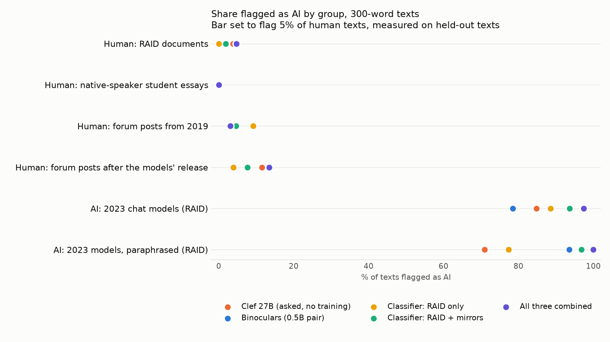
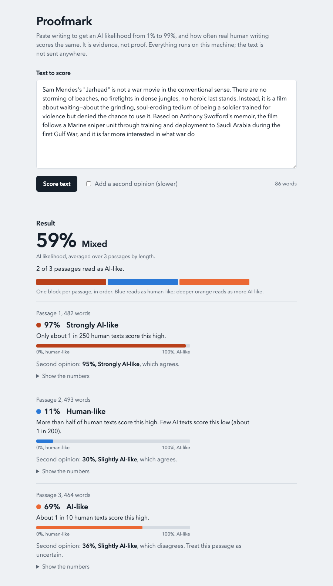

# ai-text-detection-eval

How well can AI-written text be told from human writing, and what improves it?

This repository is a small, reproducible experiment. It compiles labelled texts and compares three kinds
of detector on them:

1. asking a general-purpose *decision model* (Cloudflare's Clef, on Workers AI) with no training;
2. statistical detectors that need no training (Binoculars, Fast-DetectGPT);
3. a classifier trained on examples, with and without examples from current models.

It is an evaluation harness, not a detector. Nothing here should be used to accuse anyone of using AI.

## Results in brief (15 November 2026)

All numbers below are measured on texts that were not used to set the flagging bar. "AI caught" is the
share of AI texts flagged when the bar is set so that 5% of human texts would be flagged.

**Read the next section with these tables.** The "humans flagged" figures here hold for the public human
texts in the test sets. On one student's private, pre-ChatGPT school writing the asked model flagged 42%,
not 5%, and the combinations that include it broke the same way.

**Short texts (150 words or fewer)**

| Detector | AUROC | AI caught | Humans actually flagged | AI caught, bar set for 1% |
|---|---|---|---|---|
| Clef 27B, asked "what percentage is AI-generated?" | 0.89 | 65% | 5% | 40% |
| Binoculars (0.5B model pair) | 0.81 | 45% | 2% | 35% |
| Classifier trained on RAID (2023 models) | 0.88 | 61% | 5% | 33% |
| Classifier, RAID then updated with 943 current-model "mirrors" | 0.98 | 92% | 8% | 85% |
| Clef + Binoculars + classifier, combined | 0.99 | 95% | 7% | 71% |

**The same 1,003 documents at three lengths**

| Detector | 75 words | 150 words | 300 words |
|---|---|---|---|
| Clef 27B, asked | 49% | 59% | 76% |
| Binoculars | 51% | 69% | 73% |
| Classifier, RAID only | 60% | 69% | 69% |
| Classifier, RAID + mirrors | 78% | 85% | 91% |
| All three combined | 86% | 93% | 95% |


What the comparison shows:

- **Length helps every detector, the asked model most.** Clef goes from 49% caught at 75 words to 76% at
  300 on the same documents, and from 63% to 74% between 300 and 500 words on the documents that long.
  The classifier gains little past 300 words (91% to 95%).
- **Training on examples beats asking, but only with examples from current models.** A classifier trained
  on 2023-era text catches 29% of 2026-model text in the short set. After a twelve-minute update on 943
  texts from four current models it catches 84%, and 76% of text from four current models it never saw
  (88% at 300 words).
- **Different kinds of detector make different mistakes, so they combine well.** At 300 words Clef catches
  76% and Binoculars 73%; a logistic regression over the two catches 89%, and over all three 95%. With
  the bar set for 1% of humans the three together catch 87%, against 50 to 62% for any one alone. The
  three questions put to Clef in the first study did not combine this way, because they are one opinion.
- **Binoculars with a small model pair is weak on short current-model text.** It catches 18% of
  2026-model text at 150 words and 66% at 300. The published method uses 7B models; this 0.5B pair is a
  floor, not a fair ceiling.
- **A simple "humanizer" halves what the asked model catches at 300 words, and does not fool the
  classifier.** Clef flags 77% of 2026-model texts and 42% of their humanized rewrites (8 of 19). The
  mirror-trained classifier flags all 19.
- **Classifiers lean against non-native writers; Clef did not here.** The RAID-only classifier flags 8 of
  47 non-native TOEFL essays and 0 of 48 native student essays. After the update it flags 4 and 1. Clef
  flags 0 and 1. The samples are small, and this is the bias Liang et al. reported for 2023 detectors.
- **Edited text still has no clean answer, and the detectors disagree about it.** When a 2026 model
  polishes a human forum post or essay, the classifier flags 24 of 27 and Clef flags 6 of 27, although
  Clef's score rose for 96% of the pairs.
- **Recent human posts look more AI-like than 2019 posts** to two unrelated detectors: Clef flags 6 of 52
  recent posts against 2 of 65 from 2019, the classifier 6 against 1. Several of the highest-scoring
  recent posts read as written with AI help. So "human writing published in 2026" is not a clean human
  sample, and this test cannot say whether Clef recognises older text from its training.
- **The smaller Clef models stay weak with longer text:** 47% (Clef-flash) and 40% (Clef-omni) at 300 words.

Full tables: [results/comparison.md](results/comparison.md) (all detectors) and
[results/report.md](results/report.md) (first study: three Clef models, three questions).
Machine-readable: [results/comparison.json](results/comparison.json), [results/summary.json](results/summary.json).



## False accusations on private, pre-ChatGPT writing

The public human texts above may be in the models' training data, and they are not the kind of writing
detectors are mostly used on. So the detectors were also run on one student's private Google Docs, with
the flagging bar left exactly where the public data put it (5% of public human texts). 300-word passages:

| Detector | Public human texts | Private, dated before 30 Nov 2022 | Private school work, undated | Private journal, 2024 | Private, dated since (AI use unknown) |
|---|---|---|---|---|---|
| Clef 27B, asked | 5% | 42% (21 of 50) | 31% (20 of 65) | not run | 50% (42 of 84) |
| Binoculars (0.5B pair) | 4% | 4% (2 of 50) | 6% (4 of 65) | 2% (1 of 65) | 19% (16 of 84) |
| Classifier, RAID only | 3% | 6% (3 of 50) | 12% (8 of 65) | 2% (1 of 65) | 32% (27 of 84) |
| Classifier, RAID + mirrors | 3% | 8% (4 of 50) | 6% (4 of 65) | 3% (2 of 65) | 48% (40 of 84) |
| Binoculars + classifier | 6% | 22% (11 of 50) | 11% (7 of 65) | 2% (1 of 65) | 57% (48 of 84) |
| Clef + Binoculars | 5% | 64% (32 of 50) | 43% (28 of 65) | not run | 76% (64 of 84) |
| All three combined | 5% | 44% (22 of 50) | 29% (19 of 65) | not run | 77% (65 of 84) |

- **Asking Clef is not safe on real student essays.** It flagged 21 of 50 passages (15 of 29 documents)
  written between 2019 and November 2022, eight times the rate the public data suggested. Passages from
  2020 were flagged as often as later ones, so this is not hidden AI use.
- **The trained classifier and Binoculars roughly held their bar** on the same passages (8% and 4%), and
  on an informal journal (2 to 3%).
- **The combinations did not.** Their weights were fitted on public human text, where this writer's essays
  would have looked unusual: the classifier's typical score for these essays sits far closer to AI text
  than public human text does, although mostly under the bar. Stacking detectors amplified that.
- **The classifier, not Clef, tells this writer's older work from recent work.** The writer says much of
  the recent work was AI-written or AI-revised. The classifier flags 48% of it against 8% of the older
  work (AUROC 0.78 between the two); Clef flags 50% against 42% (AUROC 0.59).
- **Re-setting the bar on these essays costs the classifier little.** With the bar moved to flag 5% of the
  pre-ChatGPT passages, it still catches 85% of AI text at 300 words (91% before); Clef drops from 76% to
  65% and its AUROC against this human writing is 0.77, against 0.94 for public human text.

What this does and does not show: it is one writer, mostly high-school literary essays; long documents
were cut into passages, which are not independent; and it cannot say whether Clef recognises the public
texts from training or simply finds formal school essays AI-like. Either way, a bar set on public human
text does not transfer to the writing detectors are used on. The texts, titles and per-document scores are
kept out of this repository; [results/private_writing.md](results/private_writing.md) has the full tables
at every length.

## Read this before trusting the numbers

- **Small test halves.** Each number rests on roughly 170 to 260 human and 180 to 190 AI texts. Group
  rows rest on about 20 to 110 texts, and the seen/unseen generator comparison on 24 to 34 each.
  Intervals are in the full tables.
- **A 1% bar is set by two or three texts.** The "bar set for 1%" columns are indicative only.
- **The bar does not always hold.** Set for 5% of calibration humans, the updated classifier flagged 8% of
  test humans in the short set, mostly RAID documents.
- **Private human writing was tested for one writer only.** Recent forum posts turned out to include
  AI-assisted writing, so the clean test is the private-writing section above. It covers a single
  student's school work; other writers and other genres may behave differently.
- **The combined detectors are fitted to public human text.** They should be refitted with realistic
  private human writing in the calibration data before any use.
- **The classifier's test is easier than real use.** Its human training text comes from the same seven
  RAID domains as much of the test set (different documents), and its mirrors use the same prompt style as
  the 2026 test texts. Student essays and the evaluation forum sites were kept out of training.
- **The classifier reads at most 512 tokens**, about 380 words, so it sees only the start of a 500-word text.
- **Binoculars runs on a 0.5B model pair** to fit in memory, far smaller than the published 7B pair.
- **The humanizer is one prompt**, not a commercial humanizer tool. Real tools may evade detection more.
- **Combination weights were fitted on a few hundred texts** and would need refitting for other text.
- **Calibration depends on the mix.** The sets are roughly half AI; scores read as probabilities would be
  wrong for a population that is mostly human.
- **Native essays were edited.** Their anonymisation tokens (`@CAPS1`, `@LOCATION2`) were replaced with
  plain fillers so the tokens could not mark them as corpus text.
- **Hidden reasoning was switched off for four generators** when writing the long texts and the mirrors,
  to stay inside the gateway's 60-second request limit. Their short-set texts were written with it on.
- **One generator is under-represented.** GLM 5.3 failed many of its requests, so it wrote 10 of the 20
  long texts planned for it and 193 of its 250 mirrors.
- **OpenAI's Decisions endpoint and TypeSafe AI's Jev were not tested.** The first returned HTTP 429 on
  every inference call from the account used; the second is not on Workers AI.

## The two evaluation sets

### Short set (`data/eval_set.jsonl`, 836 texts of 150 words or fewer)

| Label | Group | Texts | Source |
|---|---|---|---|
| human | `raid_human` | 160 | RAID human documents, 40 per domain (abstracts, books, news, poetry) |
| human | `essay_native` | 88 | US student essays (Liang et al. 2023, from Hewlett ASAP) |
| human | `essay_nonnative` | 91 | TOEFL essays by non-native writers (Liang et al. 2023) |
| ai | `raid_2023` | 186 | RAID generations from ChatGPT, GPT-4, Llama 2, Mistral, Cohere, MPT |
| ai | `raid_paraphrased` | 60 | RAID generations after its paraphrase attack |
| ai | `fresh_2026` | 113 | Generated for this study by eight current Workers AI models |
| ai | `humanized_2026` | 48 | Some of those, rewritten by a second model to "sound like a person" |
| mixed | `toefl_gpt4_polished` | 90 | The TOEFL essays after GPT-4 polishing (Liang et al. 2023) |

### Long set (`data/long_set.jsonl`, documents of 300 to 500 words)

Each document is scored cut to 75, 150, 300 and, where it is long enough, 500 words, so the effect of
length is measured on the same documents rather than on different ones.

| Label | Group | Documents | Source |
|---|---|---|---|
| human | `raid_human` | 210 | RAID human documents from seven domains (books, news, poetry, recipes, reviews, Reddit, Wikipedia) |
| human | `essay_native` | 76 | US student essays (Liang et al. 2023), those of 255 words or more |
| human | `forum_recent` | 116 | Stack Exchange questions posted from 10 October 2026, after the Clef models were released |
| human | `forum_2019` | 120 | Questions from the same sites and weeks of 2019 |
| ai | `raid_2023` | 166 | RAID generations from six 2023-era chat models |
| ai | `raid_paraphrased` | 64 | RAID generations after its paraphrase attack (books and news) |
| ai | `fresh_2026` | 148 | Generated for this study by eight current Workers AI models, in the RAID genres plus forum questions and student essays |
| ai | `humanized_2026` | 47 | Some of those, rewritten by a second model to "sound like a person" |
| mixed | `polished_2026` | 56 | Human forum posts and student essays tidied by a current model |

Human and AI texts share source titles where a title exists, so topics match. Every text is stripped of
chat markdown and collapsed to single spaces. Field descriptions are in [data/README.md](data/README.md).

## The detectors

1. **Asking a decision model** (no training). Each text is sent to a Clef model as its `state` with one
   typed question per request ([src/detecteval/questions.py](src/detecteval/questions.py)). The first
   study compared three questions; the percentage question ("What percentage of this text is
   AI-generated?", five levels) did best on `clef` and is the one used in the comparison.
2. **Binoculars and Fast-DetectGPT** (no training). Both measure how predictable a text is to a pair of
   small language models ([src/detecteval/binoculars.py](src/detecteval/binoculars.py)). The published
   versions use 7B-parameter models; this one uses a 0.5B pair so it fits in about 3 GB of memory.
3. **A trained classifier.** A DistilRoBERTa encoder (82M parameters) fine-tuned on RAID, in two
   versions: RAID only (2023-era machine text), and RAID plus "mirrors", texts written by four current
   models on the titles of human training documents
   ([src/detecteval/train_data.py](src/detecteval/train_data.py)).
4. **Combinations.** A logistic regression over the detectors' scores, fitted on the calibration half.

Every score is oriented so that higher means more likely AI.

## Reproduce

Prerequisites: Python 3.11+, [uv](https://docs.astral.sh/uv/). Calling the Clef models and generating
text also needs a Cloudflare account with Workers AI.

```sh
git clone https://github.com/ichen27/ai-text-detection-eval.git
cd ai-text-detection-eval
uv sync
bash ci/run.sh                        # lint and unit tests; needs no credentials
uv run python -m detecteval.report    # first study: rebuild report and figures from committed scores
uv run python -m detecteval.compare   # comparison of all detectors from committed scores
```

Those commands use only what is committed. To rerun the pipeline, create `.env` in the repository root
(it is ignored by Git):

```sh
MCP_URL=https://mcp.cloudflare.com/mcp     # or a gateway that fronts it
MCP_TOKEN_FILE=/path/to/cloudflare-api-token.txt
MCP_TOOL_PREFIX=                           # set if your gateway prefixes tool names
RAW_DATA_DIR=raw                           # where raw downloads and trained models go
```

The token needs Workers AI read and run permission.

First study (short set):

```sh
uv run python -m detecteval.fetch_raid       # about 2.4 GB download, then a seeded sample
uv run python -m detecteval.fetch_essays
uv run python -m detecteval.generate         # paid: fresh and humanized texts; outputs differ each run
uv run python -m detecteval.build_dataset
uv run python -m detecteval.score clef-flash clef clef-omni
uv run python -m detecteval.score clef-flash clef clef-omni --variant joint
uv run python -m detecteval.score clef-flash clef clef-omni --variant repeat --limit 100
uv run python -m detecteval.report
```

Second study (long set, local detectors, classifier):

```sh
uv run python -m detecteval.fetch_raid_full        # 0.8 GB
uv run python -m detecteval.fetch_stackexchange    # about 200 unauthenticated API requests
uv run python -m detecteval.build_long_set         # human and RAID texts
uv run python -m detecteval.generate_long          # paid: long AI, humanized and polished texts
uv run python -m detecteval.build_long_set         # again, to merge the generated texts in
uv run python -m detecteval.score_long clef --question pct_ai
uv run python -m detecteval.score_long clef-flash clef-omni --question author --rungs 150 300

uv sync --group ml                                 # PyTorch and Transformers for the local detectors
uv run python -m detecteval.binoculars
uv run python -m detecteval.generate_mirrors --shard 0 --of 1     # paid: about 1,000 training texts
uv run python -m detecteval.generate_mirrors --merge
uv run python -m detecteval.train_classifier raid
uv run python -m detecteval.train_classifier mirrors
uv run python -m detecteval.classify raid mirrors
uv run python -m detecteval.compare
```

Scoring, generation and Binoculars are resumable: finished items are skipped on a rerun. The local
detectors need a few gigabytes of free memory each; run them one at a time. A request through an MCP
gateway may be cut off after 60 seconds, so `generate_long` turns off hidden reasoning for four models
and asks the slowest one for fewer words.

Verified here: the pipeline ran through a private MCP gateway in front of Cloudflare's API MCP server.
Pointing `MCP_URL` directly at `https://mcp.cloudflare.com/mcp` uses the same tool and should behave the
same, but that path was not run.

## Use the detector: web app and MCP server

The trained classifier, with Binoculars as an optional second opinion, runs as a small local service.
It has a web page and an MCP endpoint. It does not include Clef, which flagged too much real student
writing to be shown as a signal. Nothing leaves the machine.



A result never says "AI" or "human". For each passage of up to 500 words it gives a band (none, weak,
moderate, strong) and the numbers behind it: how many human reference texts score at least as high, and
how many AI reference texts score at most as high. The band follows the stricter human reference.

```sh
uv sync --group ml --group serve
# put the trained classifier in RAW_DATA_DIR/models/mirrors (release v0.3.0, see Artifacts)
uv run python -m detecteval.calibration      # reference scores from the committed results
uv run python -m detecteval.serve            # http://127.0.0.1:8941
```

- **Web page:** `http://127.0.0.1:8941/`. JSON API: `POST /api/detect` with `{"text": "...", "binoculars": false}`.
- **MCP:** streamable HTTP at `http://127.0.0.1:8941/mcp`, tools `detect_ai_text` and
  `about_ai_text_detector`. The endpoint answers only requests addressed to localhost, so a reverse proxy
  that serves the page under another hostname does not expose it.
- **Hosts:** the service answers for `localhost` and `127.0.0.1`. To serve the page through a reverse
  proxy, set `DETECTOR_ALLOWED_HOSTS` to its hostname. The scoring API rejects cross-site browser requests.
- **Memory:** the service itself is about 50 MB. The models run in a worker process that starts on the
  first request (10 to 30 seconds) and is stopped after five idle minutes. The classifier needs about
  0.5 GB; Binoculars adds about 3 GB and is skipped when the machine is short of memory.
- **A harder human reference:** if you have run the private-writing test, `python -m detecteval.calibration
  --private` adds your own certainly-human documents as a second reference. It stays outside the repository.

[launcher.json](launcher.json) is the manifest this project's own deployment uses with a personal app
launcher; its paths are specific to that machine and are not needed to run the service.

## Testing your own writing

Private documents written before language models were common are the cleanest test of false accusations:
they cannot be in any model's training data and cannot be AI-assisted.

1. Create `RAW_DATA_DIR/private/manifest.jsonl` with one JSON object per line:
   `{"id": "doc-001", "group": "own_pre_ai", "text": "..."}`. `group` is free text; use one group for
   writing you are sure is unassisted and another for anything else.
2. `uv run python -m detecteval.private_eval clef` (paid; sends each text to Clef on your Workers AI
   account; add `--skip-group NAME` to keep a group on your machine), then `uv run python -m detecteval.private_eval local` (needs `uv sync --group ml` and the
   trained classifiers).
3. `uv run python -m detecteval.private_eval report` writes `results/private_writing.md`.

The flagging bar and combination weights are the ones set on the long set's calibration half, so your
documents play no part in choosing them. Texts and per-document scores stay under `RAW_DATA_DIR/private`;
the report contains counts and rates only.

### Cost

Paid calls go to Workers AI. The first study's committed scores account for about 4 million input tokens
(roughly 0.60 US dollars at list prices). The second study adds about 3.2 million input tokens of Clef
scoring (about 0.55 dollars) and 1,200 generated texts of about 340 words each. With discarded trial runs
and failed requests the whole project is estimated at 3 to 8 dollars. This is an estimate, not a bill.
Binoculars and the classifier run locally: about 30 minutes and 60 minutes on an Apple M4, using 3 to
5 GB of memory.

## Artifacts

| Artifact | Where | Format | How to use or reproduce |
|---|---|---|---|
| Both evaluation sets | [data/eval_set.jsonl](data/eval_set.jsonl), [data/long_set.jsonl](data/long_set.jsonl) | JSON Lines | Fields in [data/README.md](data/README.md) |
| Generated texts and training mirrors | [data/](data/) | JSON Lines | `generate`, `generate_long`, `generate_mirrors` |
| Scores per detector | [results/scores/](results/scores/), [results/scores_long/](results/scores_long/), [results/detectors/](results/detectors/) | JSON Lines | `score`, `score_long`, `binoculars`, `classify` |
| Reports | [results/report.md](results/report.md), [results/comparison.md](results/comparison.md), [results/private_writing.md](results/private_writing.md), with `.json` twins | Markdown, JSON | `report`, `compare`, `private_eval report` |
| Figures | [results/figures/](results/figures/) | PNG | `report`, `compare` |
| Reference scores for the detector app | [results/calibration.json](results/calibration.json) | JSON | `calibration` |
| Trained classifiers (2 × 306 MB) | [release v0.3.0](https://github.com/ichen27/ai-text-detection-eval/releases/tag/v0.3.0) | Hugging Face model folders, gzipped tar | Extract into `RAW_DATA_DIR/models/`, then `python -m detecteval.classify raid mirrors`; or retrain with `train_classifier` |

SHA-256 of the release files: `classifier-raid.tar.gz` `81ae99d8aa214fe596a5799cac1b5a19c8f67da5989284e9639a3431d535a9f5`,
`classifier-mirrors.tar.gz` `84b41fcb72116e3a19c03e13c670aeccfc1a08f0184dead8b409ab02825b9d0e`.

Raw third-party downloads are not redistributed; [data/README.md](data/README.md) lists the commands that
fetch them.

## Layout

```
src/detecteval/   pipeline modules (see AGENTS.md for which belongs to which study)
data/             both evaluation sets, the texts generated for them, training mirrors
results/          report.md, summary.json      first study
                  comparison.md, comparison.json   all detectors on held-out halves
                  private_writing.md, .json        false accusations on private writing (aggregates only)
                  scores/, scores_long/, detectors/   raw scores per detector
                  figures/
launcher.json     deployment manifest for the detector app (machine-specific)
docs/screenshots/ the detector page
tests/            unit tests for metrics, text preparation, splits, detector statistics and result bands
ci/run.sh         single lint-and-test entry point used locally and in CI
```

## Contributing and issues

Open an issue for a wrong number, a broken command or a dataset concern. For changes, branch from `main`,
run `bash ci/run.sh`, and open a pull request; the `test` check must pass before merging. If you change
a dataset, prompts or the seed, regenerate scores and reports in the same pull request.

## Licence and attribution

No licence has been chosen for the code yet, so default copyright applies. The evaluation sets include
short excerpts from RAID and from Liang et al. (2023), both MIT-licensed, and Stack Exchange posts under
CC BY-SA 4.0, which stay under that licence. Sources, attributions, the papers whose methods are
implemented here and the models downloaded at run time are listed in
[THIRD_PARTY_NOTICES.md](THIRD_PARTY_NOTICES.md).
